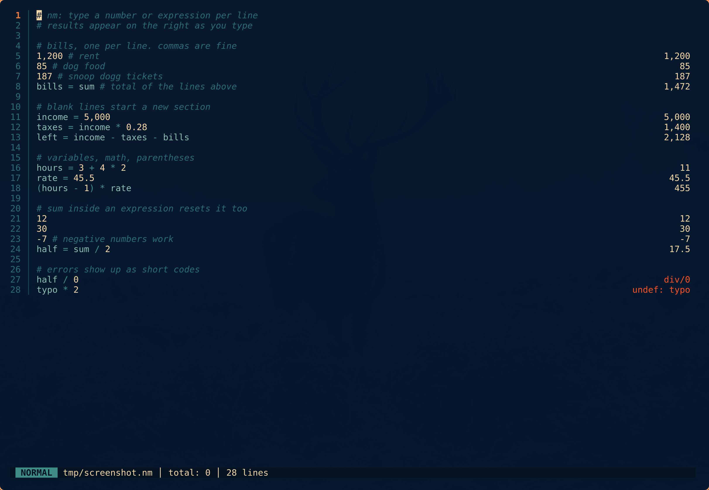

<p align="center">
  
</p>

## What Is It

`nm` is like this cool calculator thing. I think it's written in rust but honestly you'd have to check. _nm_ stands for **NUMERICAL MALICE** or **NECROTIC MATHEMATICS** or **NAPALM MULTIPLIER**, probably. It is loosely inspired by [Numi](https://numi.app/) which is definitely better, but Numi doesn't run on linux and doesn't run in the terminal. If you're on a mac you should probably just buy Numi tbh.

You type numbers and expressions into a text pad, one per line. Every line is
evaluated as you type and its result appears in a column on the right. The
editor is vim-flavoured, so `hjkl`, `dd`, `ciw`, counts, `.` and `u` all work
the way your fingers expect.

## Install

On Linux or macOS, the install script fetches the right prebuilt binary:

```sh
curl --proto '=https' --tlsv1.2 -LsSf https://github.com/nclark/nm/releases/latest/download/necromat-installer.sh | sh
```

Or grab the tarball for your platform from the
[releases page](https://github.com/nclark/nm/releases) and put `nm` on your
`PATH` yourself.

Or build it from crates.io:

```sh
cargo install necromat
```

The crate is `necromat`; the command it installs is `nm`.

Heads up: binutils also ships a program called `nm`, the symbol lister. If you
have a C toolchain installed, whichever `nm` comes first on your `PATH` wins.
`~/.cargo/bin` is usually ahead of `/usr/bin`, so this one.

## Use

```sh
nm              # resume the last session
nm budget.nm    # open (or create) a file
```

With no argument, `nm` is a scratchpad. Whatever you typed is saved when you
quit and comes back next time. The session file lives at
`~/.local/share/nm/last-session.nm`, or under `$XDG_DATA_HOME` if that is set.

With a file argument, it is an editor. `:w` saves, `:q` quits, and `:q` on an
unsaved file refuses until you `:w` or `:q!`. `ZZ` saves and quits.

`?` shows the help screen. The full key reference is in
[doc/keys.md](doc/keys.md).

## The pad



The rules:

- **A number on its own line** is a value. Thousands separators are allowed
  (`1,234.56`) and must be grouped properly (`12,34` is an error).
- **An expression** uses `+ - * /` and parentheses. `-` works as a unary
  minus: `5 * -2`.
- **`name=expr`** assigns a variable. Spaces around `=` are optional. The
  line still shows its value, and the value still counts toward the running
  total. Names are letters, digits
  and `_`, and must not start with a digit.
- **`sum`** on its own line shows the running total of the lines above it and
  resets the total to zero. Inside an expression, `sum` is that total as a
  value, and using it also resets. `bills = sum` captures a total into a
  variable.
- **A blank line** resets the running total. Use blank lines to split the pad
  into sections.
- **`#`** starts a comment. A line that is only a comment is ignored.

Results show up to five decimals, with trailing zeros trimmed: `1234.5`
displays as `1,234.5`, `1/3` as `0.33333`, `3000` as `3,000`. Values keep
full precision inside; only the display is rounded.

Errors show a short code in the results column instead of a value:

| Code | Meaning |
|---|---|
| `undef: x` | `x` has not been assigned above this line |
| `div/0` | Division by zero |
| `parens` | Mismatched parentheses |
| `syntax` | The line could not be read (bad number, stray character) |

The status bar at the bottom shows `total:` for the section the cursor is in.

### Completion

In insert mode, start typing a variable name assigned above and nm shows the
rest of it as dim ghost text. `Tab` accepts it, `Ctrl+N` and `Ctrl+P` cycle
through other matches.

### Yank

`yy` copies the line to the system clipboard. `yr` copies the line's result,
formatted, which is handy for pasting a total somewhere else.

### Theme

nm uses Tokyo Night colours out of the box. On Omarchy it picks up the
active desktop theme by itself, and follows theme switches while it is
running.

To set your own colours, write `~/.config/nm/theme.toml` (or
`$XDG_CONFIG_HOME/nm/theme.toml`) with any of these keys, each set to a
`"#rrggbb"` string; keys you leave out keep the theme underneath:
`number`, `operator`, `variable`, `comment`, `keyword`, `error`, `result`,
`status_bg`, `status_fg`, `badge_normal`, `badge_insert`, `badge_visual`,
`gutter`, `current_line_nr`, `separator`, `ghost`, `visual_bg`, `visual_fg`.

## `nm eval`

`nm eval` is the calculator without the editor. It reads a pad from standard
input and writes one JSON object per input line to standard output. It exists
so editor plugins, scripts and tests can use nm's rules without a terminal.

```sh
$ printf 'rent = 1200\n85 # dog food\nrent / 4 + 1,000\nsum\n\nbogus * 2\n' | nm eval
{"line":1,"value":1200.0,"text":"1,200","error":null}
{"line":2,"value":85.0,"text":"85","error":null}
{"line":3,"value":1300.0,"text":"1,300","error":null}
{"line":4,"value":2585.0,"text":"2,585","error":null}
{"line":5,"value":null,"text":"","error":null}
{"line":6,"value":null,"text":"undef: bogus","error":"undefined variable: bogus"}
```

Each object has these keys, always in this order:

| Key | Holds |
|---|---|
| `line` | 1-based line number of the input line |
| `value` | The numeric result, or `null` when the line has none (blank, comment, error, or a non-finite result) |
| `text` | Exactly what the results column would show: the formatted number, the short error code, or `""` |
| `error` | The full error message, or `null` |

Lines are evaluated top to bottom with the same variables and running total
as the editor, so a whole file piped in gives the same answers the editor
shows. Empty input prints nothing. The exit code is 0 whenever the input was
read, even if every line is an error.

The output format is a stable interface. Changing it is a breaking change.

## Build from source

Rust stable, via [mise](https://mise.jdx.dev/) if you use it (`mise.toml` is
in the repo).

```sh
cargo build --release
just ci        # tests, clippy, fmt
```

Design notes for contributors are in [doc/design/](doc/design/README.md).

## License

[WTFPL](LICENSE).
